<div align="center">

<a href="https://elpasha3000.github.io/Screen2ipcam/">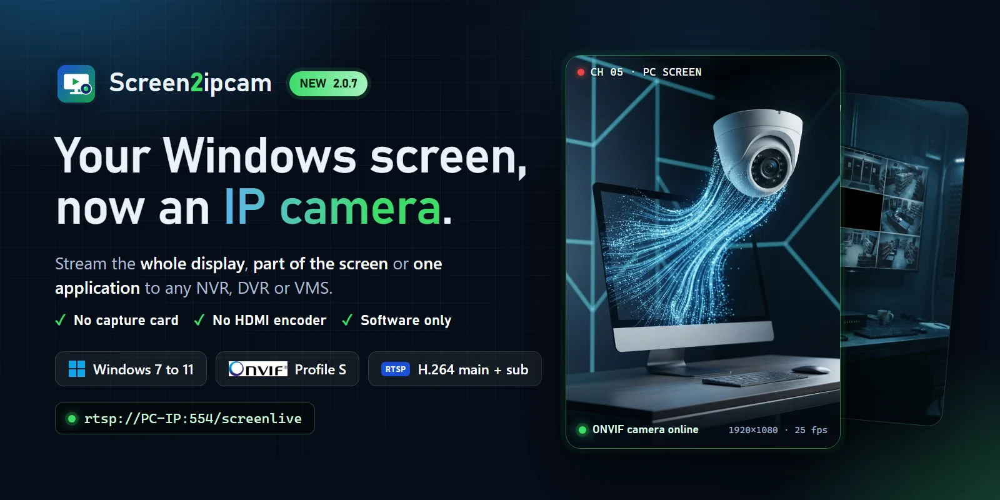</a>

# Screen2ipcam 2.0.7

### Virtual IP camera software for Windows

Turn a Windows PC **screen**, **part of it**, or **one application** into a standard **ONVIF / RTSP IP camera**,<br>
recorded by any **NVR, DVR or VMS**, with **no capture card** and **no hardware encoder**.

<br>

&nbsp;
&nbsp;


&nbsp;
&nbsp;
&nbsp;
&nbsp;
&nbsp;
<a href="https://sourceforge.net/projects/screen2ipcam/"></a>&nbsp;
<a href="https://www.softpedia.com/get/Internet/Streaming/Screen2ipcam.shtml"></a>

<br>

<a href="https://screen2ipcam.com/dl207/x64/ghr"></a>&nbsp;
<a href="https://screen2ipcam.com/dl207/x86/ghr"></a>

<sub>Free 14-day trial with every feature unlocked · Installs over your current version and keeps your license and settings</sub>

<br><br>

[**🆕 New in 2.0.7**](#whats-new) &nbsp;·&nbsp; [**🎬 Videos**](#videos) &nbsp;·&nbsp; [**🤝 Works with**](#works-with) &nbsp;·&nbsp; [**🎯 Motion recording**](#motion) &nbsp;·&nbsp; [**🖧 Windows Server**](#windows-server) &nbsp;·&nbsp; [**⬇️ Download**](#download) &nbsp;·&nbsp; [**📜 Versions**](#versions) &nbsp;·&nbsp; [**❓ FAQ**](#faq)

🌐 **[screen2ipcam.com](https://screen2ipcam.com/?src=github)** &nbsp;·&nbsp; 📄 **[Product page](https://elpasha3000.github.io/Screen2ipcam/)** &nbsp;·&nbsp; 🌍 [English](https://screen2ipcam.com/?src=github) · [العربية](https://screen2ipcam.com/ar/?src=github) · [Português](https://screen2ipcam.com/pt/?src=github) · [Español](https://screen2ipcam.com/es/?src=github) · [Français](https://screen2ipcam.com/fr/?src=github) · [Deutsch](https://screen2ipcam.com/de/?src=github) · [Русский](https://screen2ipcam.com/ru/?src=github) · [日本語](https://screen2ipcam.com/ja/?src=github) · [简体中文](https://screen2ipcam.com/zh/?src=github)

</div>

<br>

## 🎯 What is Screen2ipcam?

Screen2ipcam is **virtual IP camera software**. It runs on a Windows PC and publishes the screen as a standard **ONVIF Profile S** camera with an **H.264 RTSP** stream (main + sub). Your NVR, DVR or VMS discovers it like any other IP camera and records it next to your real cameras. No HDMI encoder, no capture card, no extra PC.

```
PC screen  →  H.264  →  ONVIF / RTSP  →  your NVR, DVR or VMS
```

| | | |
|---|---|---|
| 🧾 **POS & cashier screens** | 🏭 **Factories: SCADA / HMI** | 📊 **Dashboards & control rooms** |
| 💊 **Pharmacies & clinics** | 🚚 **Warehouses & logistics** | 🎓 **Schools & exam centers** |
| 🏪 **Shops & branches** | 🖥️ **Kiosks & front desks** | 📺 **Digital signage** |

> Used responsibly and lawfully. See the License Agreement. The operator is solely responsible for obtaining any required consents.

<br>

<a id="whats-new"></a>
## 🆕 New in 2.0.7: choose exactly what the camera shows

<div align="center">
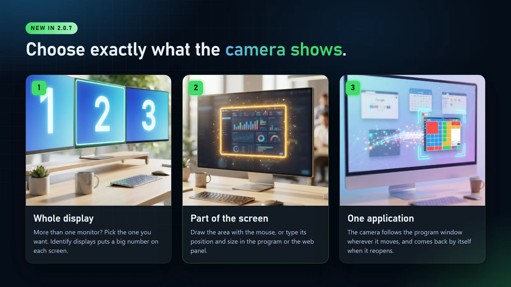
</div>

<br>

| | |
|---|---|
| 🖥️ **Whole display** | More than one monitor? Pick the display you want. **Identify displays** shows a big number on each screen. |
| ✂️ **Part of the screen** | Draw the area with the mouse, then press **Enter** or double-click inside it. You can also type the position and size, in the program or in the web panel. |
| 🪟 **One application** | The camera follows the program window wherever it moves. If the program is closed, a waiting screen appears and the stream comes back by itself. |
| 👁️ **Live preview** | Shows exactly what the recorder will see. |
| 📈 **Steadier timelines** | Steadier recording timelines on professional video management systems. |
| 💡 **Help tips** | Hover over an option for a short explanation. The camera screens show the program version. |

<div align="center">
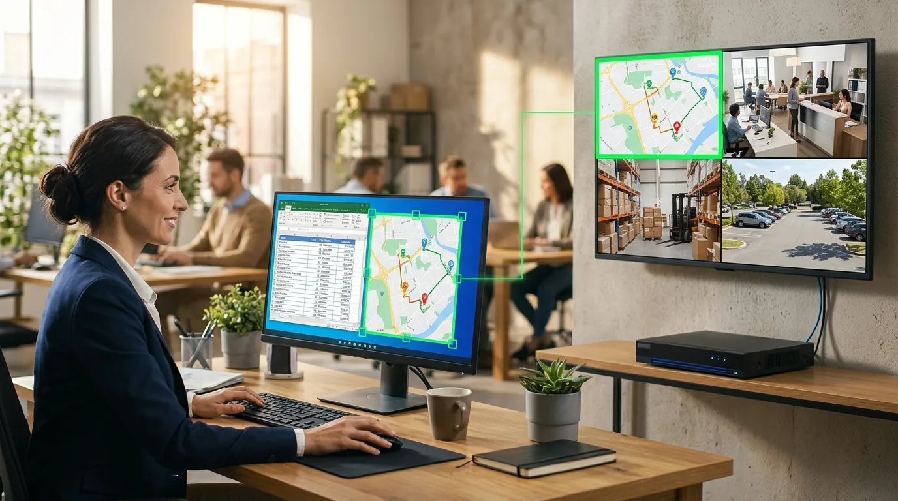
<br><sub><b>Part of the screen:</b> only the selected area, here the map, appears on the recorder</sub>
<br><br>

| | |
|:--:|:--:|
| 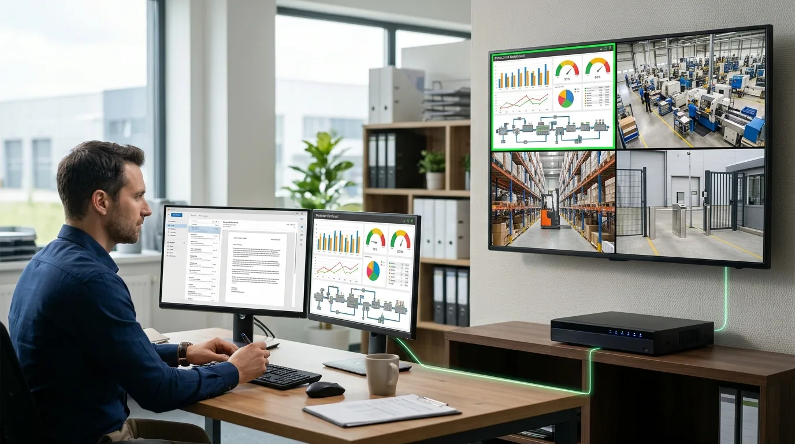 | 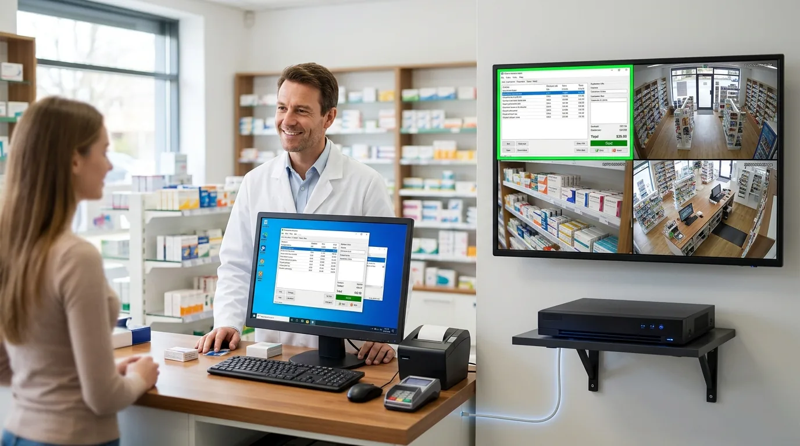 |
| Two monitors: only the dashboard screen is recorded | One application: only the cash register program goes to the recorder |

</div>

Everything from **2.0.5** is still here: motion recording, the mouse pointer, sound and the on-screen extras. 2.0.7 installs over your current version and keeps your license and settings.

<details>
<summary><b>📸 The new Source tab in the app</b> <i>(click to expand)</i></summary>
<br>

| | | |
|:--:|:--:|:--:|
| 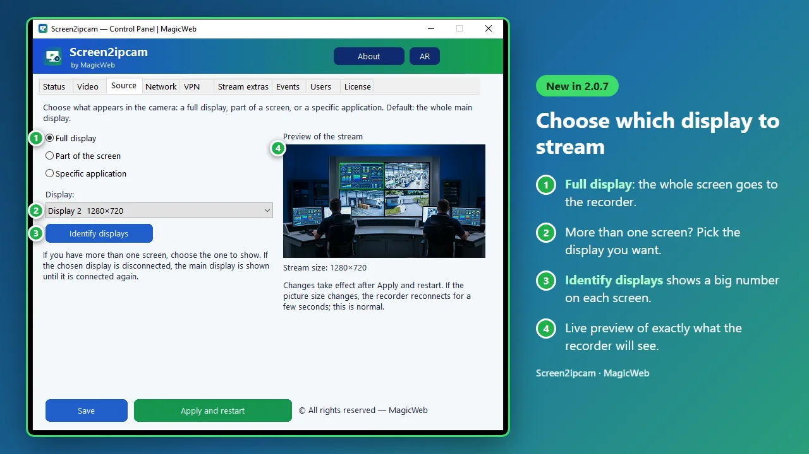 | 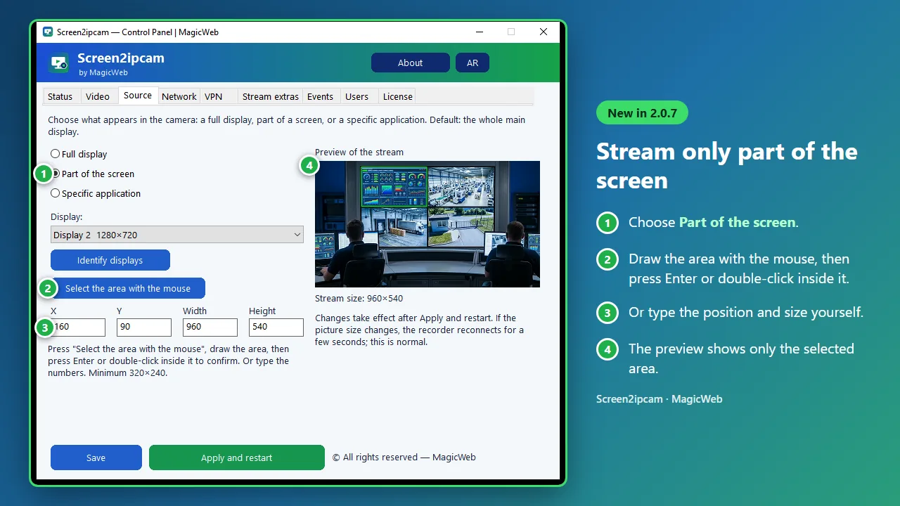 | 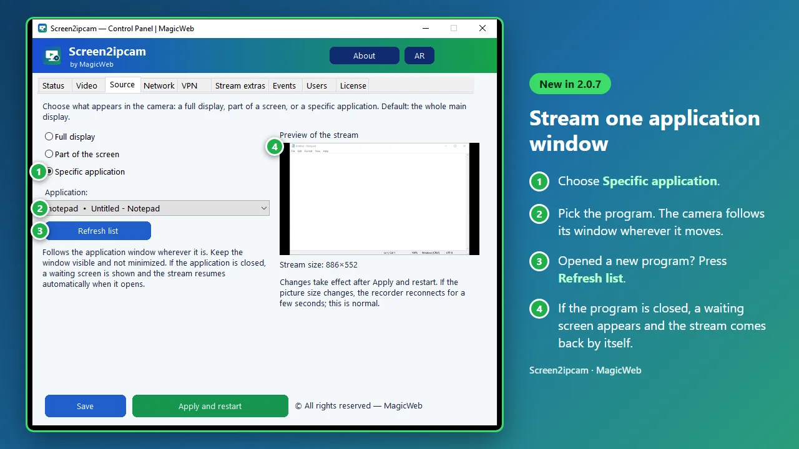 |
| **Display** | **Part of the screen** | **Application** |

</details>

📝 **[Full release notes](https://screen2ipcam.com/updates.html?src=github)**

<br>

<a id="videos"></a>
## 🎬 See it working

<div align="center">

<a href="https://www.youtube.com/watch?v=ZVe3uEKP43I">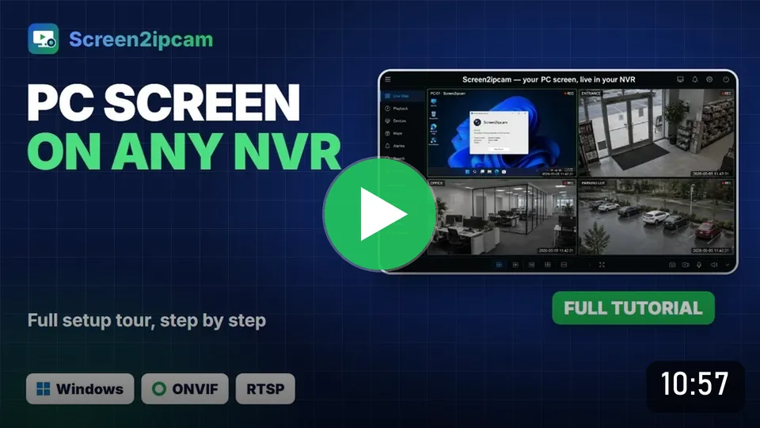</a>
<br><sub><b>Full guide:</b> record a PC or POS screen on any NVR over ONVIF / RTSP</sub>

<br><br>

| | | |
|:--:|:--:|:--:|
| <a href="https://www.youtube.com/watch?v=yrkmlVbfoj8">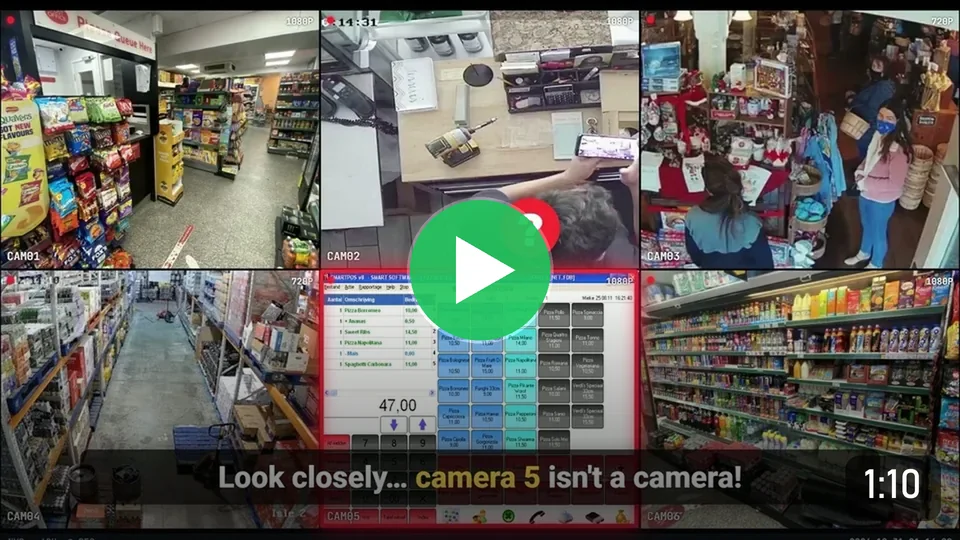</a> | <a href="https://www.youtube.com/watch?v=haeQu4SZTnQ">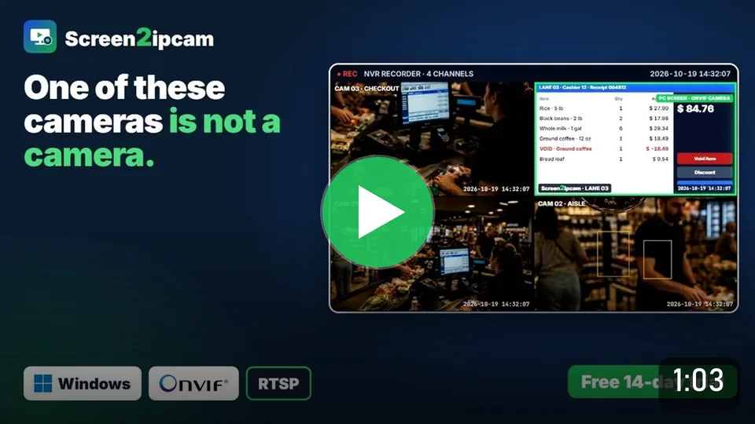</a> | <a href="https://www.youtube.com/watch?v=x8wikYQeV7c">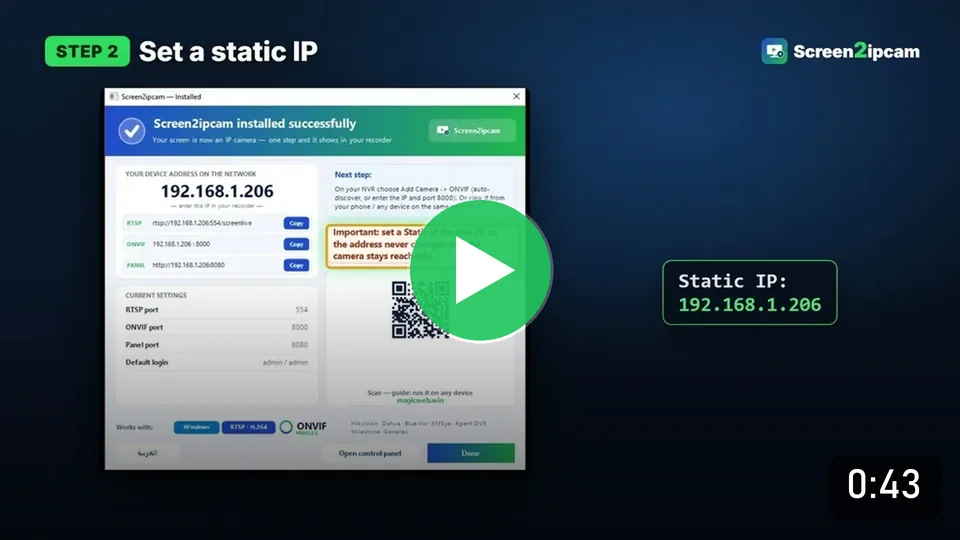</a> |
| Camera 5 is not a camera: a cashier screen on an NVR | Record any PC screen on your NVR | Your PC as an ONVIF IP camera in one minute |
| <a href="https://www.youtube.com/watch?v=00qRO1LfY8o">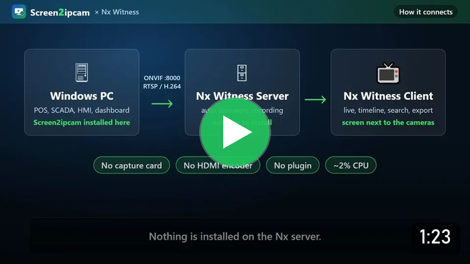</a> | <a href="https://www.youtube.com/watch?v=2Jz4zVoEs30">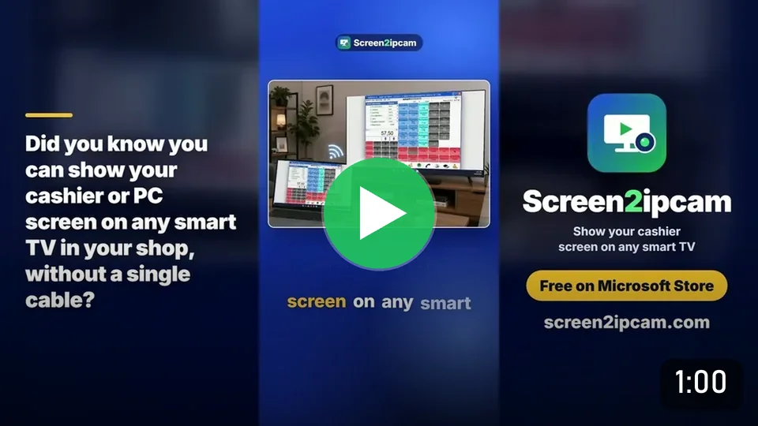</a> | <a href="https://www.youtube.com/watch?v=dImaMbHljXc">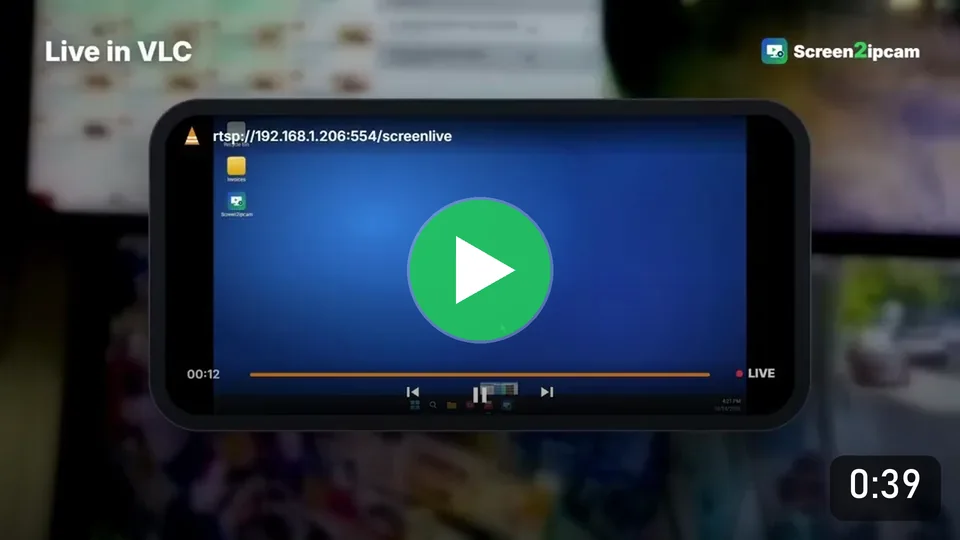</a> |
| Screen2ipcam with Nx Witness | A PC screen on any smart TV, no cables | Live in VLC on your phone over RTSP |

🎞️ **[All videos](https://screen2ipcam.com/media/?src=github)**

</div>

<br>

<a id="works-with"></a>
## 🤝 Works with your recorder

<div align="center">
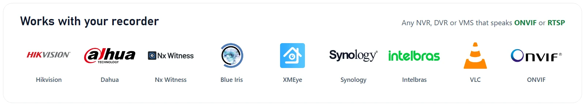
</div>

<br>

Tested with **Hikvision**, **Dahua**, **Uniview**, **XMEye**, **Blue Iris** and **Agent DVR**. Listed in the official **Nx Integration Directory**, verified on a live **Pelco VideoXpert** system, and works with **Salient CompleteView**, **Milestone XProtect**, **Synology / QNAP Surveillance Station**, **Intelbras**, **Frigate** and any player such as **VLC**. In short: anything that speaks standard **ONVIF** or **RTSP**.

📘 Step by step guides: [Hikvision](https://screen2ipcam.com/integrations/hikvision/?src=github) · [Dahua](https://screen2ipcam.com/integrations/dahua/?src=github) · [Blue Iris](https://screen2ipcam.com/integrations/blue-iris/?src=github) · [Intelbras](https://screen2ipcam.com/integrations/intelbras/?src=github) · [Pelco VideoXpert](https://screen2ipcam.com/integrations/pelco-videoxpert/?src=github) · [Salient CompleteView](https://screen2ipcam.com/integrations/salient-completeview/?src=github) · [All integrations](https://screen2ipcam.com/integrations/?src=github)

<div align="center">
<br>
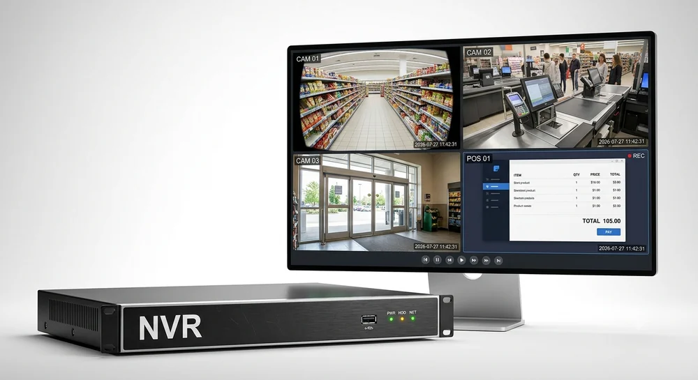
<br><sub>A cashier screen as one more channel in the NVR, right next to the store cameras</sub>
</div>

<br>

<a id="motion"></a>
## 🎯 Motion recording (since 2.0.5)

A PC screen sits still for most of the day. Since **2.0.5**, Screen2ipcam can tell the recorder **the moment the screen changes**, so the recorder records and alerts only then. 2.0.7 keeps it.

| | |
|---|---|
| 🎯 **Motion events over standard ONVIF** | The recorder records only when the screen changes, the same way it handles motion from a real camera. The timeline fills only where something happened, the disk lasts much longer, and searching is faster. Optional, **off by default**. |
| 🧪 **Send test event** | Sends one motion event to the recorder, so you can confirm it reacts before you leave the site, without touching the screen. |
| 🖱️ **Mouse pointer** | Windows does not include the pointer when a program captures the screen. Screen2ipcam can draw it in, so the recording shows where the operator clicked. Optional. |
| 🔊 **Sound and on-screen extras** | The PC's own audio inside the same stream (**G.711**), plus the camera name and the date and time on the picture, with your choice of corner, colour, size and opacity. |

<div align="center">
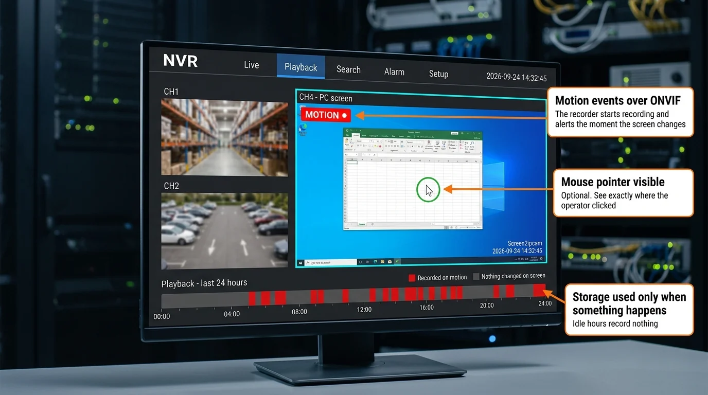
<br><sub>Illustration: the recorder stores only the moments when the screen changed</sub>
</div>

<br>

**How to switch it on**

1. In Screen2ipcam, open the **Events** tab, switch on **Send motion events to the recorder**, then press **Apply and restart**.
2. On the recorder, enable motion detection and motion recording for that channel. Hikvision calls it Motion Detection, Dahua calls it IVS or Video Detect, XMEye calls it Detect.
3. If the camera was added before you switched events on, delete the channel and add it again once, so the recorder reads the new capabilities.
4. Back in the Events tab press **Send test event**. The motion or recording icon should appear on the recorder within a second.

📄 How motion recording works: **[English](https://screen2ipcam.com/motion/?src=github)** · [العربية](https://screen2ipcam.com/motion/ar/?src=github) · [Português](https://screen2ipcam.com/motion/pt/?src=github)

<br>

<a id="windows-server"></a>
## 🖧 2.0.5 for Windows Server

An edition for **servers, POS terminals and shared PCs**: machines that run around the clock and are not always logged in.

| | |
|---|---|
| 🔒 **Streams without a logged-in user** | The service runs the camera on the logon screen itself. After a reboot or a log off, the recorder still sees the screen and never shows Video Loss. |
| 📌 **Fixed ports** | RTSP **554**, ONVIF **18000**, web panel **13030**. Set the recorder and the firewall once. |
| 🚀 **Silent install on many machines** | Save the settings of one PC to `Screen2ipcam-settings.txt`, keep it next to the installer, and run it with `/SILENT /SUPPRESSMSGBOXES` from any deployment tool. |
| 🖥️ **Remote Desktop aware** | When a technician connects over RDP, the camera follows the active session, and goes back to the operator's screen by itself afterwards. |

Runs on **Windows Server 2016 to 2025** and on Windows 7 to 11 PCs. Same lifetime license as the standard edition, one per machine. 📄 [Edition page](https://screen2ipcam.com/windows-server/?src=github)

<br>

<a id="download"></a>
## ⬇️ Download: free 14-day trial

| | Download | Notes |
|---|---|---|
| 💾 | **[Screen2ipcam 2.0.7, 64-bit](https://screen2ipcam.com/dl207/x64/ghr)** | Latest version, most PCs |
| 🖥️ | **[Screen2ipcam 2.0.7, 32-bit](https://screen2ipcam.com/dl207/x86/ghr)** | Latest version, older / embedded / POS |
| 🖧 | [2.0.5 for Windows Server, 64-bit](https://screen2ipcam.com/dl/x64ws/ghr) · [32-bit](https://screen2ipcam.com/dl/x86ws/ghr) | Servers, POS terminals, shared PCs |
| 🕘 | [Previous version 2.0.5, 64-bit](https://screen2ipcam.com/dl/x64new/ghr) · [32-bit](https://screen2ipcam.com/dl/x86new/ghr) | The version that introduced motion recording |
| 📦 | [SourceForge mirror](https://sourceforge.net/projects/screen2ipcam/files/) | Earlier builds and checksums |
| 📘 | [User guide](https://screen2ipcam.com/guide/?src=github) | Ports, NVR setup, Hikvision and Dahua |

Windows 7 SP1 to Windows 11, 32-bit and 64-bit. The trial is **14 days, fully functional**. A lifetime license unlocks the full version for one PC: **no watermark, no time limit**.

<br>

<a id="features"></a>
## ✨ Features

| | |
|---|---|
| 📡 **ONVIF Profile S** | Auto-discovered by NVRs (WS-Discovery), or add by IP |
| 🎬 **RTSP H.264** | **Main + Sub** streams: `rtsp://PC-IP:554/screenlive` and `/screensub` |
| 🖥️ **Capture source** | Whole display, part of the screen, or one application window *(new in 2.0.7)* |
| 🎯 **Motion events (ONVIF)** | The recorder records only when the screen changes. Optional, off by default |
| 🖱️ **Mouse pointer** | Optionally drawn into the stream and the snapshots |
| 📸 **JPEG snapshot** | Standard `GetSnapshotUri` support |
| 🔊 **Audio (G.711)** | Streams the PC's own sound with the video, recorded by the NVR |
| 🏷️ **On-screen extras** | Camera name and date/time on the picture, your choice of corner |
| 👁️ **Connected devices** | See who is watching right now, from where, and for how long |
| 🌐 **VPN & address control** | Pick the address the recorder sees, with a built-in network check |
| 🪶 **Light on the PC** | About 2% CPU while streaming, no .NET, native C++ |
| 🪟 **Windows 7 SP1 → 11** | 32-bit & 64-bit, IoT / Embedded / POSReady too |
| 🛠️ **Always-on** | Installs as a Windows Service, or runs as a tray app |
| 🎛️ **3 ways to configure** | Desktop app · web panel · config file |
| 🔒 **Stream security** | Optional ONVIF / RTSP authentication (Digest / WS-Security) |
| 🌍 **Bilingual app** | English / العربية |

<br>

<a id="how"></a>
## 🔌 How it works

1. **Install**: [download](#download) the installer (64-bit or 32-bit) and run it.
2. **Choose the source** in the app: the whole display, part of the screen, or one application. Default login `admin` / `admin`.
3. **On your NVR:** Add Camera → **ONVIF** (auto-discover, or enter the PC's IP and port `8000`; `18000` for the Windows Server edition). Done, it records like any camera.

| Port | Protocol | Purpose |
|:---:|:---:|---|
| `554` | TCP | RTSP stream |
| `8000` | TCP | ONVIF service |
| `8080` | TCP | Web admin panel *(not needed by the NVR)* |
| `3702` | UDP | WS-Discovery *(optional, you can add by IP instead)* |

For a segmented camera VLAN, the NVR only needs to reach the PC on **554** and **8000**.

<br>

<a id="shots"></a>
## 🖼️ Screenshots

<div align="center">

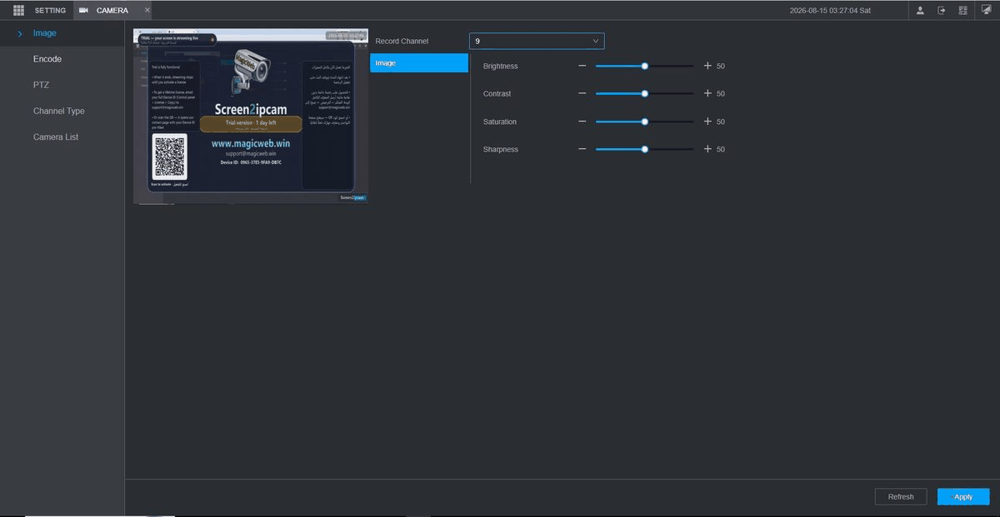
<br><sub>A real Dahua NVR playing the PC screen as an ordinary camera channel</sub>

<br><br>

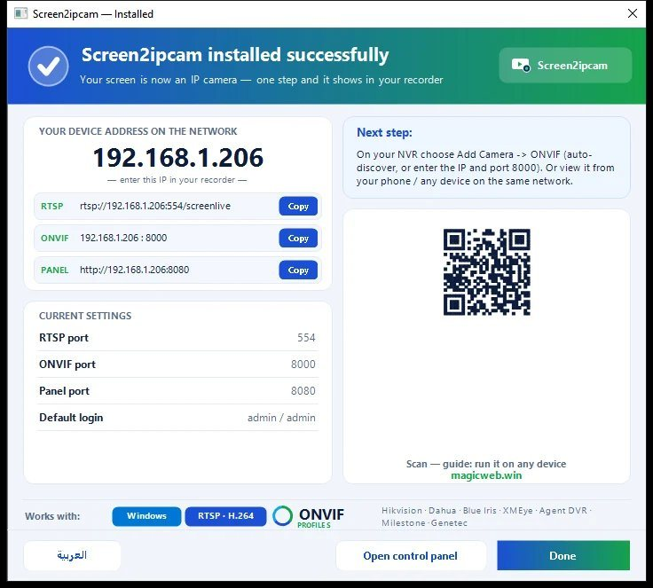
<br><sub>Right after install: the address, links and ports, each with a Copy button</sub>

</div>

<details>
<summary><b>🪟 More screenshots: desktop app, web panel, installer</b> <i>(click to expand)</i></summary>
<br>

**Desktop control panel**: stream settings, tray icon, and service status
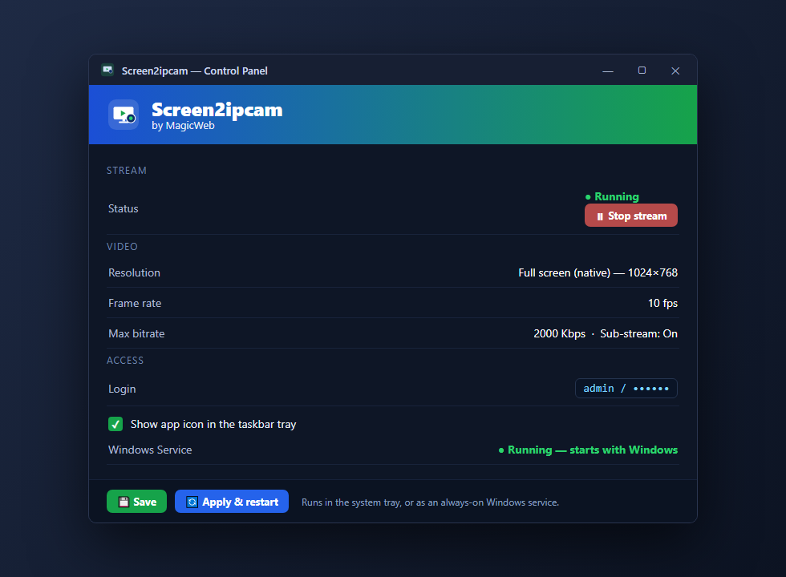

**VPN tab**: choose the address the recorder should see, run a network check, copy the RTSP link
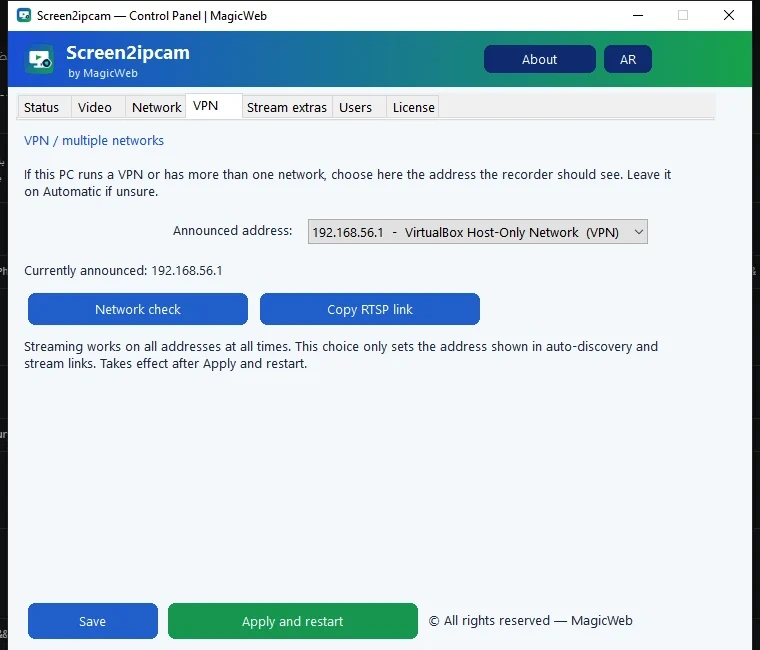

**Stream extras tab**: audio, camera name, date and time, privacy alert
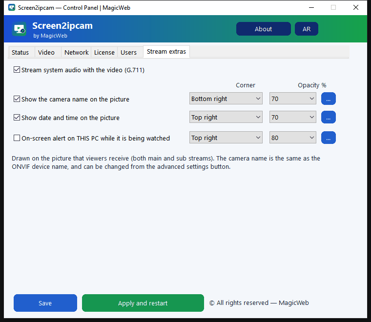

**Status tab**: the recorders connected right now
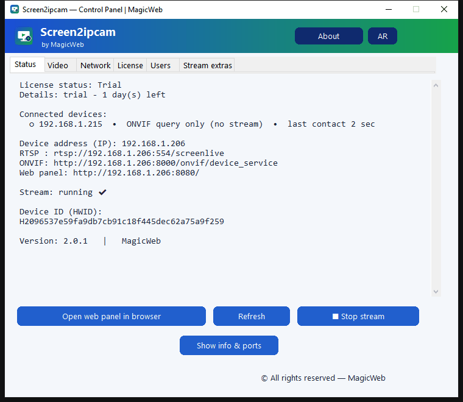

**Web panel, System / License**: device ID, license status, and activation QR
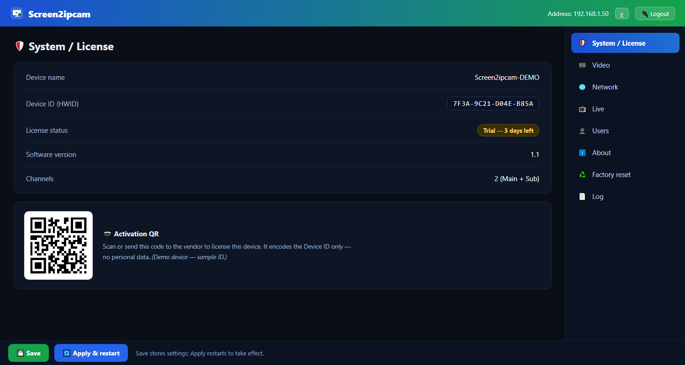

**Installer**: desktop shortcut, run at startup, and install as a Windows service
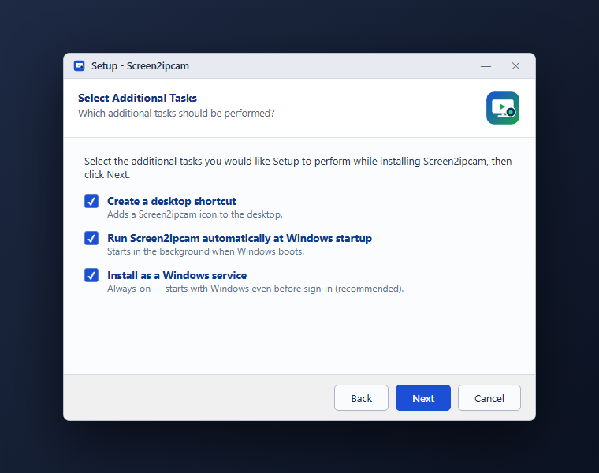

**View the stream anywhere**: PC, Android, iPhone / iPad, Smart TV, NVR / DVR, web browser
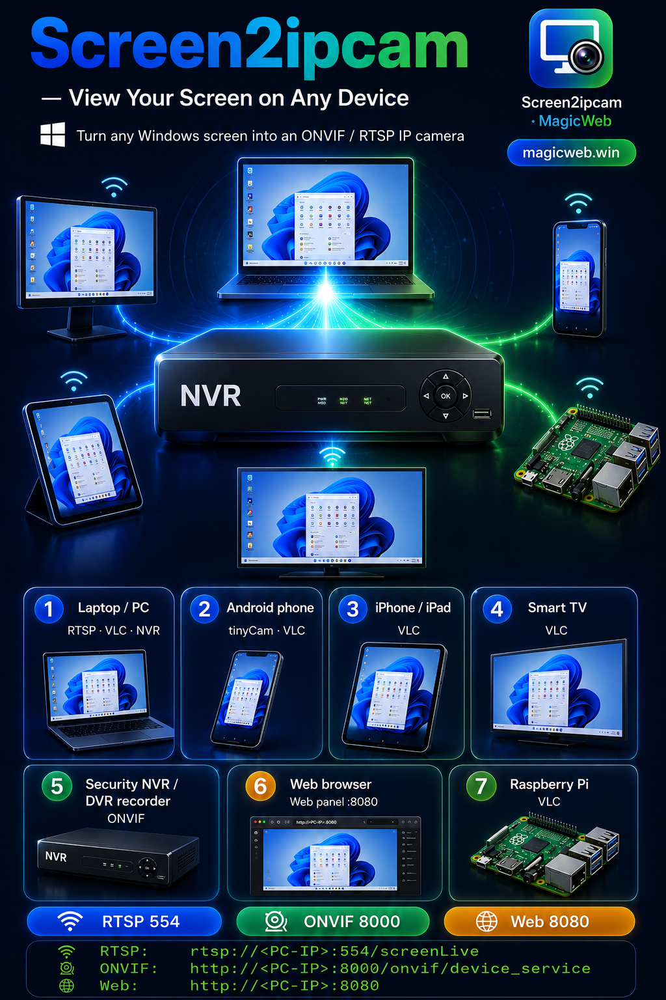

</details>

<br>

<a id="versions"></a>
## 📜 Version history

| Version | What changed |
|:---:|---|
| **2.0.7** 🆕 | **Choose what the camera shows:** the whole display, part of the screen, or one application window. Identify displays, live preview, steadier timelines on professional VMS, help tips. |
| **2.0.5** | 🎯 **Motion recording** over standard ONVIF: the recorder records only when the screen changes. Mouse pointer in the stream, sound and on-screen extras, a **Send test event** button, easier license activation. New edition: **2.0.5 for Windows Server**. |
| **2.0.3** | More stable connection with recorders: the app answers the checks some recorders (Uniview among them) send while streaming. Wider support for sub stream names, and a **Check firewall** button. |
| **2.0.2** | **VPN tab**: choose the address the recorder sees, run a network check, copy the RTSP link. VPN and virtual adapters are skipped automatically, and the camera identity is tied to the PC hardware. |
| **2.0.1 and earlier** | The foundation: ONVIF Profile S discovery, RTSP H.264 main and sub streams, the web panel, the Windows service and the 14-day trial. |

📝 **[Full release notes for every version](https://screen2ipcam.com/updates.html?src=github)** &nbsp;·&nbsp; 🕘 [Previous version 2.0.5](#download) &nbsp;·&nbsp; 📦 [Earlier builds on SourceForge](https://sourceforge.net/projects/screen2ipcam/files/)

<br>

<a id="license"></a>
## 🔑 License

| | Free trial | Lifetime license |
|---|:---:|:---:|
| Every feature unlocked | ✅ | ✅ |
| Duration | 14 days | **Forever** |
| Watermark after trial | n/a | **Never** |
| Activations | n/a | 1 PC (locked to its Device ID) |

The **Windows Server edition** uses the same lifetime license, one per machine. For 5 machines or more, all licenses can be delivered together. **[License details at screen2ipcam.com →](https://screen2ipcam.com/?src=github)**

<br>

<a id="review"></a>
## ⭐ Reviewed by Softpedia

<div align="center">

<a href="https://www.softpedia.com/get/Internet/Streaming/Screen2ipcam.shtml"></a>&nbsp;


</div>

> **"Screen2ipcam essentially turns your computer into an IP camera."**
>
> Robert Condorache · [Full review on Softpedia](https://www.softpedia.com/get/Internet/Streaming/Screen2ipcam.shtml) · rated **5.0 / 5** · **Certified 100% Clean**

<details>
<summary><b>📷 Screenshots from the Softpedia review</b> <i>(click to expand)</i></summary>
<br>

|  |  |  |
|:--:|:--:|:--:|
| 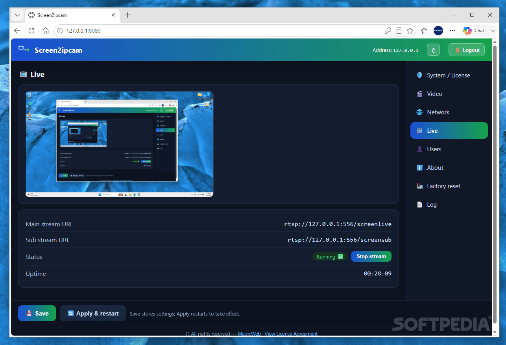 | 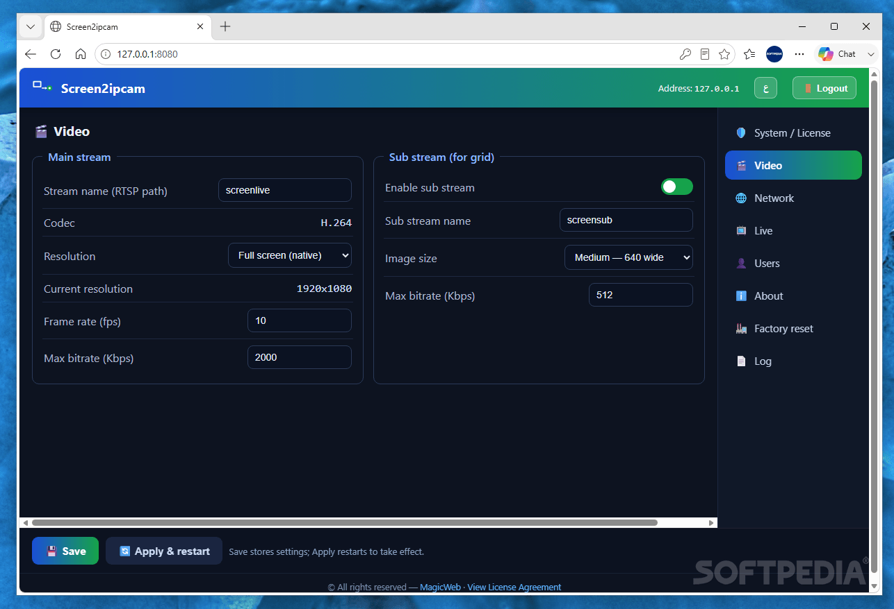 | 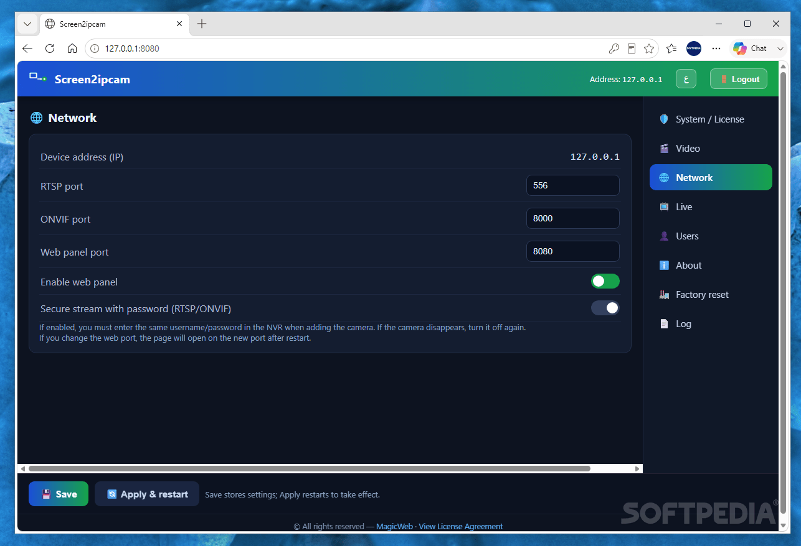 |
| **Web panel · Live** | **Web panel · Video** | **Web panel · Network** |
| 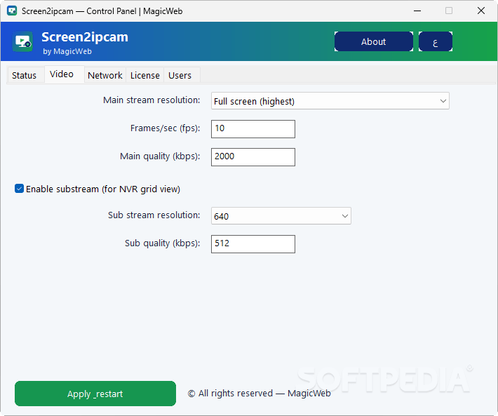 | 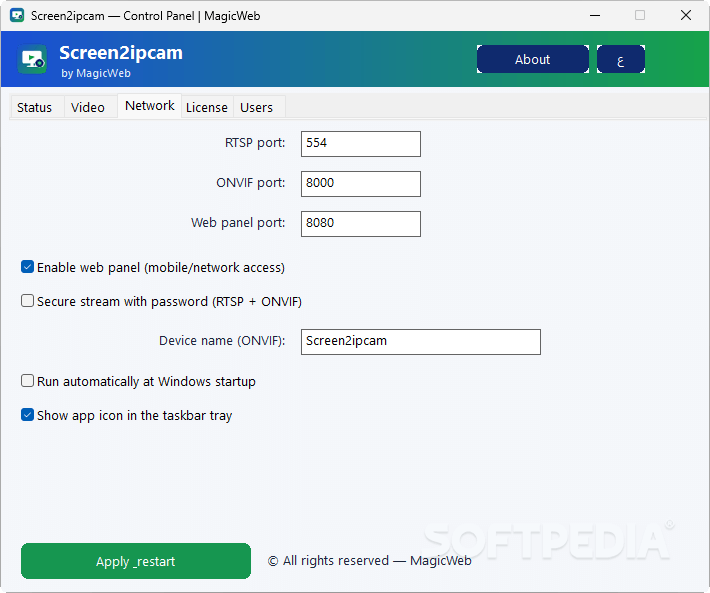 | 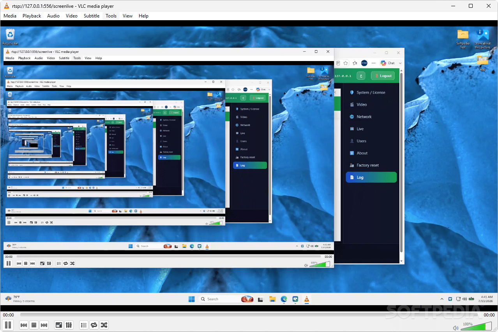 |
| **Desktop app · Video** | **Desktop app · Network** | **Verified in VLC (RTSP)** |

</details>

📚 Also listed on [Softpedia](https://www.softpedia.com/get/Internet/Streaming/Screen2ipcam.shtml) · [SourceForge](https://sourceforge.net/projects/screen2ipcam/) · [Soft112](https://screen2ipcam.soft112.com/) · [Software Informer](https://screen2ipcam.software.informer.com/)

<br>

<a id="faq"></a>
## ❓ FAQ

<details>
<summary><b>What is a virtual IP camera?</b></summary>
<br>

A program that makes something that is not a camera, here a Windows screen, look like a standard IP camera on the network. Screen2ipcam answers ONVIF discovery and serves an RTSP H.264 stream, so your NVR, DVR or VMS adds it and records it like any camera.
</details>

<details>
<summary><b>Can I stream only one program, or only part of the screen?</b></summary>
<br>

Yes, since **2.0.7**. In the Source tab choose **Part of the screen** and draw the area, or choose **Specific application** and pick the program. The camera follows that window wherever it moves, and shows a waiting screen if the program is closed until it opens again.
</details>

<details>
<summary><b>The PC has more than one monitor. Which one is streamed?</b></summary>
<br>

The one you pick. Since **2.0.7** the Source tab lists every display, and **Identify displays** shows a big number on each screen so you know which is which.
</details>

<details>
<summary><b>Can the recorder record only when the screen changes?</b></summary>
<br>

Yes, since **2.0.5**. Switch on **Send motion events to the recorder** in the Events tab, then enable motion recording for that channel on the recorder. It works over standard ONVIF, so Hikvision, Dahua, XMEye and the others treat it like motion from a real camera. Details: [screen2ipcam.com/motion](https://screen2ipcam.com/motion/?src=github).
</details>

<details>
<summary><b>Which NVRs and software does it work with?</b></summary>
<br>

Any system that supports **ONVIF** or **RTSP**. Tested with Hikvision, Dahua, Uniview, XMEye, Blue Iris and Agent DVR, listed in the official Nx Integration Directory, and verified on Pelco VideoXpert. See [Works with](#works-with).
</details>

<details>
<summary><b>Does it record sound?</b></summary>
<br>

Yes. It sends what the PC plays (not a microphone) inside the same stream using **G.711**. On the recorder choose audio compression **G.711Mu** and audio source **Local**. If the channel was added before you switched audio on, remove it and add it again once.
</details>

<details>
<summary><b>Does it keep streaming when nobody is logged in?</b></summary>
<br>

Use **[2.0.5 for Windows Server](#windows-server)**. Its service runs the camera on the logon screen itself, keeps fixed ports, and follows the active session over Remote Desktop.
</details>

<details>
<summary><b>The recorder sees the wrong IP address (VPN / virtual adapter)</b></summary>
<br>

Open the **VPN** tab and pick exactly which address the camera should announce. VPN and virtual adapters (Tailscale, Hyper-V, VMware, VirtualBox and others) are skipped automatically, and the built-in **network check** confirms the recorder can reach that address.
</details>

<details>
<summary><b>Which Windows versions are supported?</b></summary>
<br>

**Windows 7 SP1 through Windows 11**, 32-bit and 64-bit, including Windows IoT / Embedded / POSReady. The Windows Server edition also runs on **Windows Server 2016 to 2025**. No .NET or extra runtimes needed.
</details>

<details>
<summary><b>Why does Windows show a notice when I run the installer?</b></summary>
<br>

SmartScreen sometimes shows a notice for a program it has not seen often. Click **More info**, then **Run anyway**. The installer is certified **100% Clean** by Softpedia, and the download always comes from the official site.
</details>

<details>
<summary><b>How do I get and activate my license?</b></summary>
<br>

Send your **Device ID** (from the app's License tab) through the [form on the site](https://screen2ipcam.com/?src=github#contact) or by email. We send your license by email. Paste it into the License tab in any form, even on a single line. Each license activates **one PC**, locked to its Device ID.
</details>

<details>
<summary><b>How do I uninstall it?</b></summary>
<br>

**Settings → Apps**, or the **Uninstall Screen2ipcam** shortcut. It asks for the program password (default `admin` / `admin`), so a casual user can't remove it from a deployed PC. Forgot the password? Click **Forgot password?** on the web panel login and email the Device ID to **support@magicweb.win** for a reset code.
</details>

<br>

<a id="comments"></a>
## 💬 Questions & feedback

| | Where | For |
|---|---|---|
| 💬 | **[Discussions →](https://github.com/elpasha3000/Screen2ipcam/discussions)** | Questions, ideas, setup stories |
| 🐞 | **[Issues →](https://github.com/elpasha3000/Screen2ipcam/issues)** | Something didn't work |
| 📧 | **[support@magicweb.win](mailto:support@magicweb.win)** | Direct support & licensing |

Especially useful to us: your **NVR / VMS model** and the **ONVIF discovery result**.

<br>

---

<div align="center">


**Screen2ipcam 2.0.7**: Your Windows screen. Your IP camera.

🌐 **[screen2ipcam.com](https://screen2ipcam.com/?src=github)** &nbsp;·&nbsp; 📄 **[Product page](https://elpasha3000.github.io/Screen2ipcam/)** &nbsp;·&nbsp; 📧 **[support@magicweb.win](mailto:support@magicweb.win)** &nbsp;·&nbsp; 📝 **[Release notes](https://screen2ipcam.com/updates.html?src=github)**

⭐ *If Screen2ipcam is useful to you, a star helps others find it.*

<sub>© MagicWeb. All rights reserved.</sub>

</div>
