<div align="center">


# Screen2ipcam

### Your Windows screen. Your IP camera.

Turn any Windows PC **screen** into a standard **ONVIF / RTSP IP camera**,<br>
recorded by any **NVR, DVR or VMS**, with **no capture card** and **no hardware encoder**.

<br>

&nbsp;
&nbsp;


&nbsp;
&nbsp;
&nbsp;
&nbsp;
<a href="https://sourceforge.net/projects/screen2ipcam/files/latest/download"></a>&nbsp;
<a href="https://www.softpedia.com/get/Internet/Streaming/Screen2ipcam.shtml"></a>

<br>

[**⬇️ Download**](#download) &nbsp;·&nbsp; [**🆕 What's new**](#whats-new) &nbsp;·&nbsp; [**🖧 Windows Server edition**](#windows-server) &nbsp;·&nbsp; [**✨ Features**](#features) &nbsp;·&nbsp; [**🔌 How it works**](#how) &nbsp;·&nbsp; [**🖼️ Screenshots**](#shots) &nbsp;·&nbsp; [**💲 Pricing**](#pricing) &nbsp;·&nbsp; [**⭐ Review**](#review) &nbsp;·&nbsp; [**💬 Comments**](#comments)

<br>

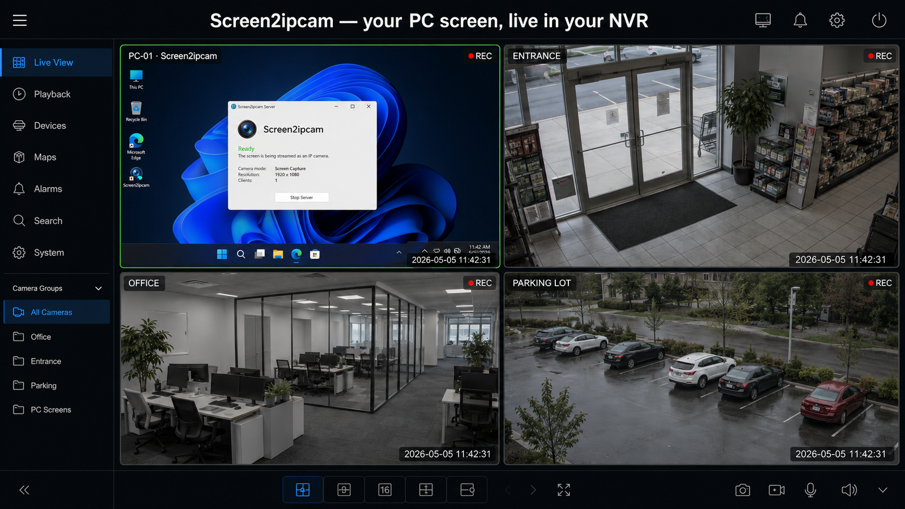

<i>A Windows PC screen, live in your NVR, right next to your real cameras.</i>

<br><br>

<a href="https://screen2ipcam.com/downloads/Screen2ipcam_Setup_x64.exe"></a>&nbsp;
<a href="https://screen2ipcam.com/downloads/Screen2ipcam_Setup_x86.exe"></a>&nbsp;
<a href="https://screen2ipcam.com/downloads/Screen2ipcam_Setup_2.0.5_WindowsServer_x64.exe"></a>

<a href="https://sourceforge.net/projects/screen2ipcam/files/latest/download"></a>

🌐 Official site: **[screen2ipcam.com](https://screen2ipcam.com/?src=github)**

🌍 In your language: [English](https://screen2ipcam.com/) · [العربية](https://screen2ipcam.com/ar/) · [Português](https://screen2ipcam.com/pt/) · [Español](https://screen2ipcam.com/es/) · [Deutsch](https://screen2ipcam.com/de/) · [Русский](https://screen2ipcam.com/ru/) · [日本語](https://screen2ipcam.com/ja/) · [简体中文](https://screen2ipcam.com/zh/)

</div>

<br>

## 🎯 What is Screen2ipcam?

Screen2ipcam runs on a Windows PC and publishes its **screen** as a standard **ONVIF Profile S** camera with an **H.264 RTSP** stream (main + sub). Your NVR, DVR or VMS (**Hikvision, Dahua, Uniview, XMEye, Blue Iris, Milestone, Genetec, Nx Witness** and others) discovers it like any other IP camera and records it. No HDMI encoder, no capture hardware, no extra PC.

### 🤝 Works with

<div align="center">

&nbsp;
&nbsp;
&nbsp;
&nbsp;
&nbsp;


&nbsp;
&nbsp;
&nbsp;
&nbsp;
&nbsp;


<sub>...and any other NVR / DVR / VMS / player that speaks standard <b>ONVIF</b> or <b>RTSP</b>.</sub>

</div>

Anywhere you'd like a screen visible inside your existing surveillance system:

| | | |
|---|---|---|
| 🧾 **POS & cashier systems** | 🏫 **Schools & training labs** | 🏭 **Factories: SCADA / HMI** |
| 🚚 **Warehouses & logistics** | 🏥 **Healthcare & lab equipment** | 🎓 **Examination centers** |
| 📊 **Dashboards & control rooms** | 🖥️ **Remote branches & kiosks** | 📺 **Digital signage** |

> Used responsibly and lawfully. See the License Agreement. The operator is solely responsible for obtaining any required consents.

<br>

<a id="whats-new"></a>
## 🆕 What's new in 2.0.5: motion recording

A PC screen sits still for most of the day. Screen2ipcam 2.0.5 can tell the recorder **the moment the screen changes**, so the recorder records and alerts only then.

**🎯 Motion events over standard ONVIF**<br>
The recorder records only when the screen changes, the same way it handles motion from a real camera. The playback timeline fills only where something happened, the disk lasts much longer, and searching gets faster because you jump straight to the blocks on the timeline. Optional, and **off by default**.

**🖱️ Mouse pointer in the stream and in snapshots**<br>
Windows does not include the pointer when a program captures the screen. 2.0.5 can draw it in, so the recording shows exactly where the operator clicked. Optional, off by default.

**🔊 Sound and on-screen extras**<br>
The PC's own audio travels inside the same stream using standard **G.711**, and the camera name and the date and time can be drawn on the picture, with your choice of corner, colour, size and opacity.

**🧪 A test button**<br>
**Send test event** sends one motion event to the recorder and then goes idle. You can confirm the recorder reacts before you leave the site, without touching the screen.

**🔑 Easier license activation**<br>
The license text is accepted however you paste it, even on a single line, with clearer messages.

**🌐 VPN and multiple networks, built in**<br>
Choose exactly which address the recorder should see, run a **network check**, and copy the RTSP link in one click. VPN and virtual adapters are detected and skipped automatically, so the camera announces the address that actually works.

2.0.5 installs over your current version and keeps your license and settings.

📄 How motion recording works: **[English](https://screen2ipcam.com/motion/?src=github)** · [العربية](https://screen2ipcam.com/motion/ar/?src=github) · [Português](https://screen2ipcam.com/motion/pt/?src=github) &nbsp;·&nbsp; 📝 **[Full release notes](https://screen2ipcam.com/updates.html?src=github)**

<div align="center">
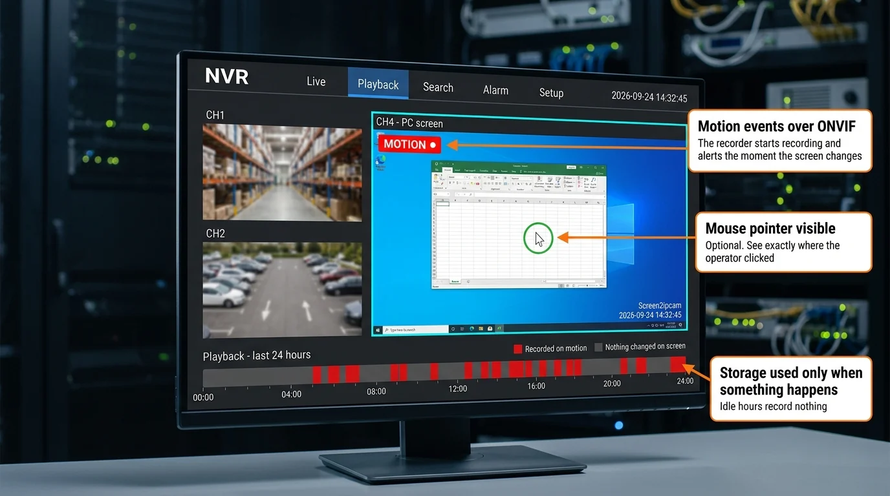
<br><sub>Illustration: the recorder stores only the moments when the screen changed</sub>
</div>

<br>

**How to switch it on**

1. In Screen2ipcam, open the **Events** tab, switch on **Send motion events to the recorder**, then press **Apply and restart**.
2. On the recorder, enable motion detection and motion recording for that channel. Hikvision calls it Motion Detection, Dahua calls it IVS or Video Detect, XMEye calls it Detect.
3. If the camera was added before you switched events on, delete the channel and add it again once, so the recorder reads the new capabilities.
4. Back in the Events tab press **Send test event**. The motion or recording icon should appear on the recorder within a second.

<br>

<a id="windows-server"></a>
## 🖧 New edition: 2.0.5 for Windows Server

An edition for **servers, POS terminals and shared PCs**: machines that run around the clock and are not always logged in. The same program, built for a different kind of machine.

**🔒 Streams without a logged-in user**<br>
The service runs the camera on the **logon screen itself**. After a reboot or a log off, the recorder still sees the screen and never shows Video Loss.

**📌 Fixed ports**<br>
RTSP **554**, ONVIF **18000**, web panel **13030**. They never change, so the recorder and the firewall rules are set once. The web panel stays reachable from any PC on the network, or over a VPN, even while the machine sits on the logon screen.

**🚀 Silent install on many machines**<br>
Install on one PC, set it up the way you like, then in the License tab click **Save settings to a file** and name it `Screen2ipcam-settings.txt`. Put that file next to the installer and run, from any deployment tool or script:

```
Screen2ipcam_Setup_2.0.5_WindowsServer_x64.exe /SILENT /SUPPRESSMSGBOXES
```

Each machine comes up ready: resolution, ports, sound, mouse pointer.

**🖥️ Remote Desktop aware**<br>
When a technician connects over RDP, the camera follows the active session, and goes back to the operator's screen by itself when they disconnect.

Runs on **Windows Server 2016 to 2025** and on Windows 7 to 11 PCs. It installs over your current version and keeps your license and settings. Same lifetime license as the standard edition, **$20 per machine**.

| | Download | |
|---|---|---|
| 💾 | [Screen2ipcam 2.0.5 for Windows Server, **x64**](https://screen2ipcam.com/downloads/Screen2ipcam_Setup_2.0.5_WindowsServer_x64.exe) | 64-bit |
| 🖥️ | [Screen2ipcam 2.0.5 for Windows Server, **x86**](https://screen2ipcam.com/downloads/Screen2ipcam_Setup_2.0.5_WindowsServer_x86.exe) | 32-bit |

📄 Edition page: **[English](https://screen2ipcam.com/windows-server/?src=github)** · [العربية](https://screen2ipcam.com/windows-server/ar/?src=github) · [Português](https://screen2ipcam.com/windows-server/pt/?src=github) · [Español](https://screen2ipcam.com/windows-server/es/?src=github) · [Deutsch](https://screen2ipcam.com/windows-server/de/?src=github) · [Русский](https://screen2ipcam.com/windows-server/ru/?src=github)

<div align="center">
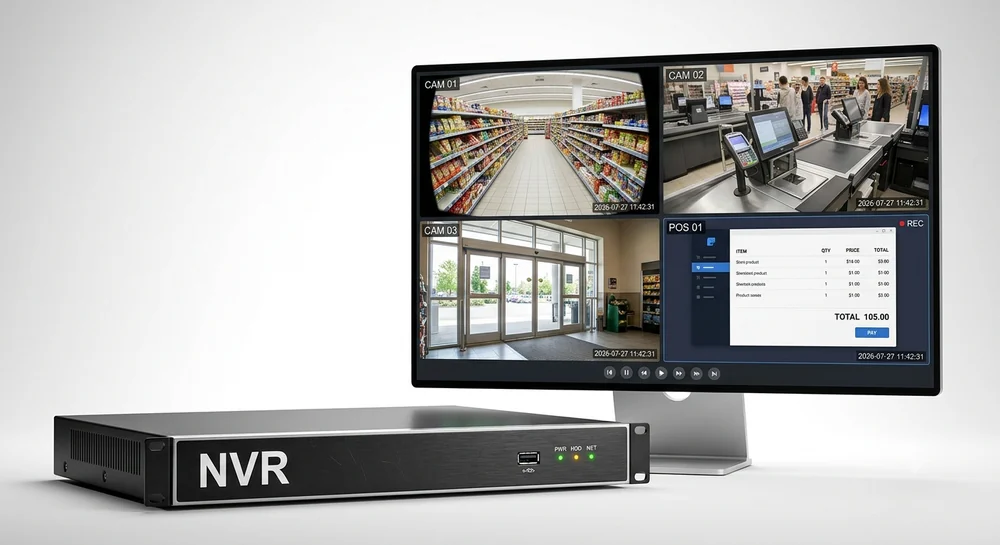
<br><sub>Illustration: a cashier screen as one more channel in the NVR</sub>
</div>

<br>

<a id="download"></a>
## ⬇️ Download: free 14-day trial

| | Download | Notes |
|---|---|---|
| 💾 | [Screen2ipcam Setup, **x64**](https://screen2ipcam.com/downloads/Screen2ipcam_Setup_x64.exe) | 64-bit, modern PCs |
| 🖥️ | [Screen2ipcam Setup, **x86**](https://screen2ipcam.com/downloads/Screen2ipcam_Setup_x86.exe) | 32-bit, older / embedded / POS |
| 🖧 | [2.0.5 for Windows Server, **x64**](https://screen2ipcam.com/downloads/Screen2ipcam_Setup_2.0.5_WindowsServer_x64.exe) | Servers, POS terminals, shared PCs |
| 🖧 | [2.0.5 for Windows Server, **x86**](https://screen2ipcam.com/downloads/Screen2ipcam_Setup_2.0.5_WindowsServer_x86.exe) | 32-bit edition |
| 🌐 | **[screen2ipcam.com](https://screen2ipcam.com/?src=github#download)** | Official site, all download options |
| 📘 | [User guide](https://screen2ipcam.com/guide/?src=github) | Ports, NVR setup, Hikvision and Dahua |
| 🎬 | [Videos](https://screen2ipcam.com/media/?src=github) | Setup and feature walkthroughs |
| 📝 | [Release notes](https://screen2ipcam.com/updates.html?src=github) | What changed in each version |

Windows 7 SP1 to Windows 11, 32-bit and 64-bit. The trial is **14 days, fully functional**. A one-time **$20** license unlocks the full version for one PC: **no watermark, no time limit**.

<br>

<a id="features"></a>
## ✨ Features

| | |
|---|---|
| 📡 **ONVIF Profile S** | Auto-discovered by NVRs (WS-Discovery), or add by IP |
| 🎬 **RTSP H.264** | **Main + Sub** streams, perfect for NVR grid views |
| 🖥️ **Live screen capture** | The full primary screen, exactly as the operator sees it |
| 🎯 **Motion events (ONVIF)** | The recorder records only when the screen changes. Optional, off by default |
| 🖱️ **Mouse pointer** | Optionally drawn into the stream and the snapshots |
| 🧪 **Test event button** | Sends one motion event so you can confirm the recorder reacts |
| 📸 **JPEG snapshot** | Standard `GetSnapshotUri` support |
| 🔊 **Audio (G.711)** | Streams the PC's own sound with the video, recorded by the NVR |
| 🏷️ **On-screen extras** | Camera name and date/time drawn on the picture, your choice of corner |
| 👁️ **Connected devices** | See who is watching right now, from where, and for how long |
| 🌐 **VPN & address control** | Pick the address the recorder sees · built-in network check · VPN-aware |
| 🪶 **Featherweight** | ~0% CPU idle · ~2% while streaming · ~60 MB RAM |
| ⚙️ **Native C++** | Static runtime, no .NET, no redistributables |
| 🪟 **Windows 7 SP1 → 11** | 32-bit & 64-bit, IoT / Embedded / POSReady too |
| 🖧 **Windows Server edition** | Streams on the logon screen, fixed ports, silent install with a settings file |
| 🛠️ **Always-on** | Installs as a Windows Service, or runs as a tray app |
| 🎛️ **3 ways to configure** | Native GUI · web panel · config file |
| 🔒 **Stream security** | Optional ONVIF / RTSP authentication (Digest / WS-Security) |
| 🌍 **Bilingual UI** | English / العربية |

<br>

<a id="how"></a>
## 🔌 How it works

```
PC screen  →  H.264 encode  →  ONVIF / RTSP  →  your NVR / VMS
```

<div align="center">

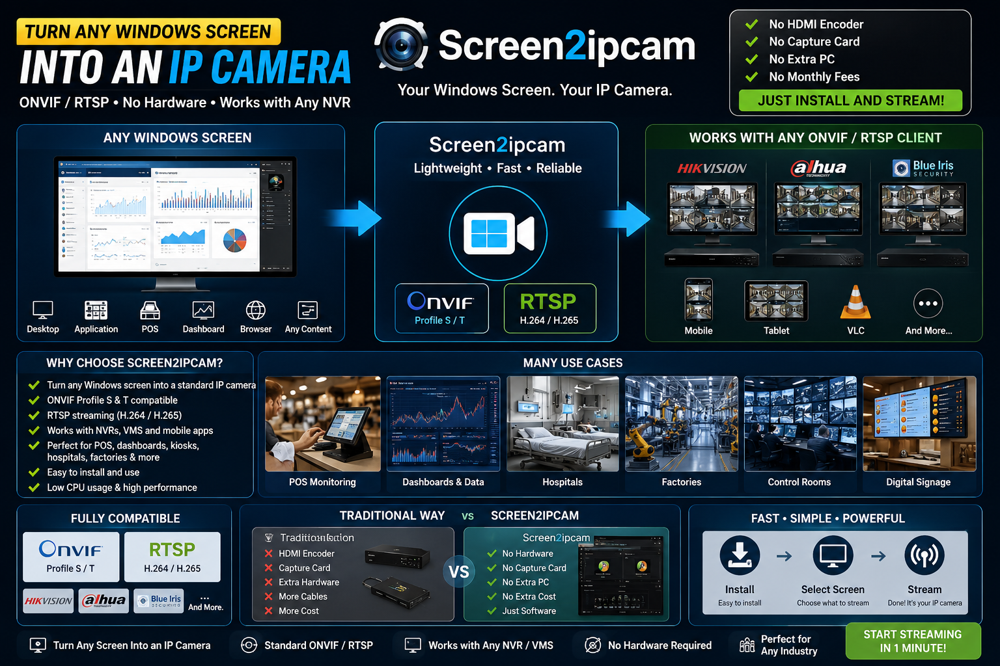

</div>

**Ports (standard edition)**

| Port | Protocol | Purpose |
|:---:|:---:|---|
| `554` | TCP | RTSP stream |
| `8000` | TCP | ONVIF service |
| `8080` | TCP | Web admin panel *(not needed by the NVR)* |
| `3702` | UDP | WS-Discovery *(optional, you can add by IP instead)* |

For a segmented camera VLAN, the NVR only needs to reach the PC on **554** and **8000**.
The **Windows Server edition** uses fixed ports: RTSP `554`, ONVIF `18000`, web panel `13030`.

### 🚀 Quick start, 3 steps

1. **Install**: [download](#download) the installer (x64 or x86) and run it.
2. **Open the control panel**: default login `admin` / `admin`.
3. **On your NVR:** Add Camera → **ONVIF** (auto-discover, or enter the PC's IP + port `8000`; `18000` for the Windows Server edition). Done, it records like any camera.

<br>

<a id="shots"></a>
## 🖼️ See it in action

<div align="center">

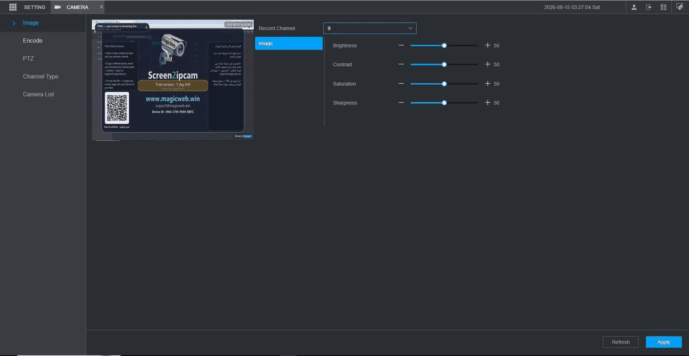
<br><sub>A real Dahua NVR playing the PC screen as an ordinary camera channel</sub>

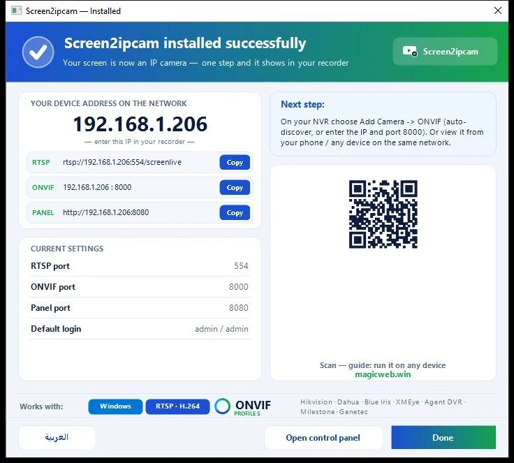
<br><sub>Right after install: the address, links and ports, each with a Copy button</sub>

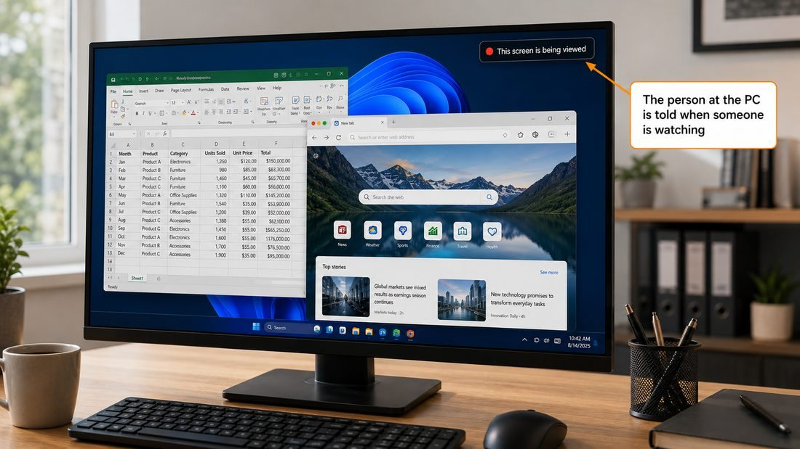
<br><sub>Illustration: the optional privacy alert, shown only on the streaming PC</sub>

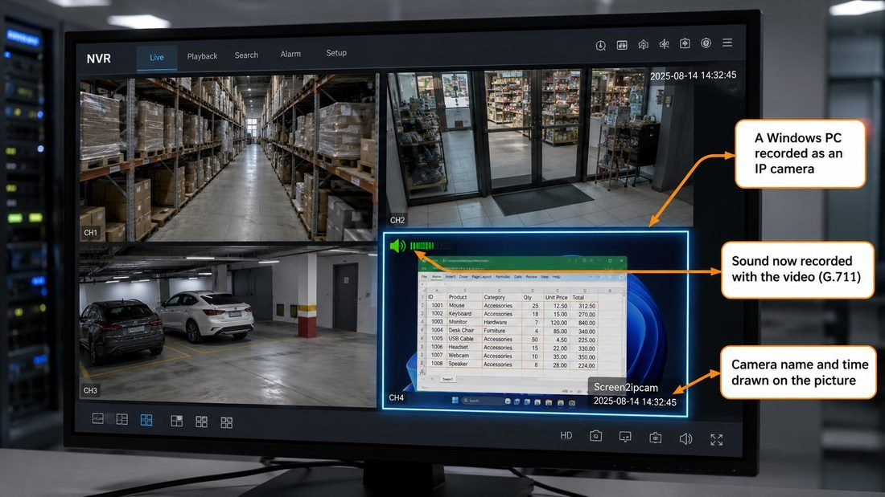
<br><sub>Illustration: how it appears on a recorder, with sound</sub>

<br><br>

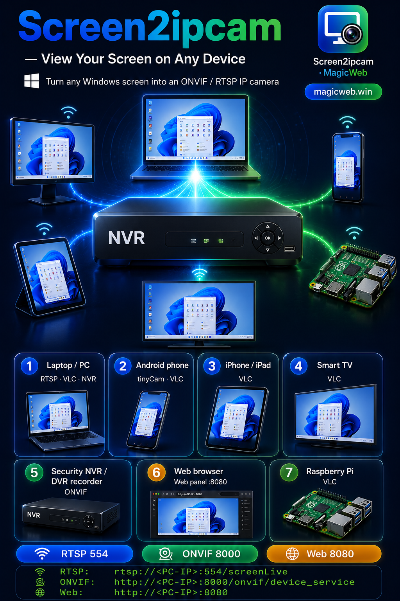

</div>

<details>
<summary><b>🖥️ Web control panel</b>, browser-based admin at <code>http://[device-ip]:8080</code> <i>(click to expand)</i></summary>
<br>

**System / License**: device ID, license status, and activation QR
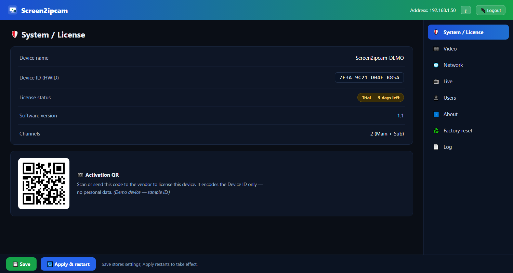

**Network**: ports & optional stream authentication


</details>

<details>
<summary><b>🪟 Windows control panel</b>, native desktop app + service installer <i>(click to expand)</i></summary>
<br>

**Desktop control panel**: stream settings, tray icon, and service status
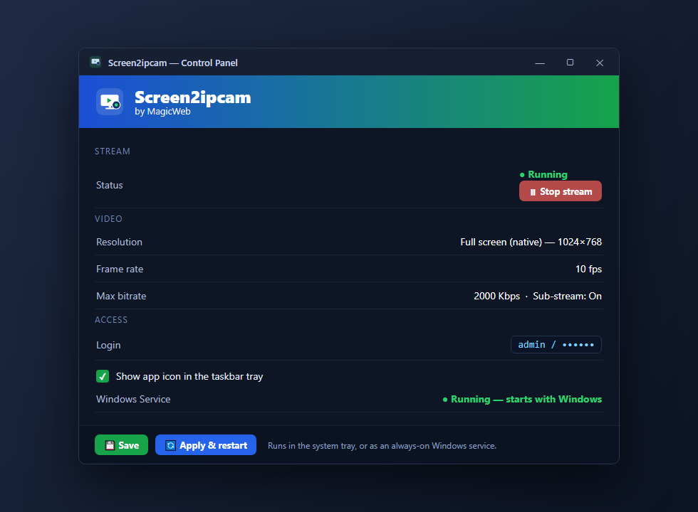

**VPN tab**: choose the address the recorder should see, run a network check, copy the RTSP link
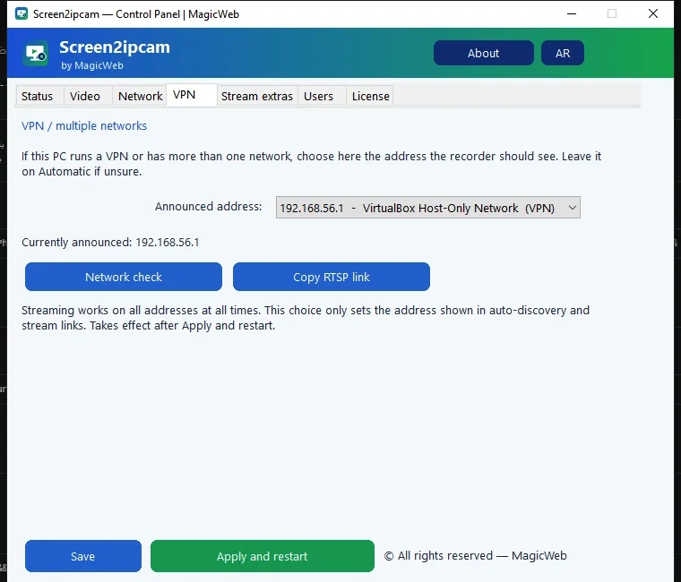

**Stream extras tab**: audio, camera name, date and time, privacy alert
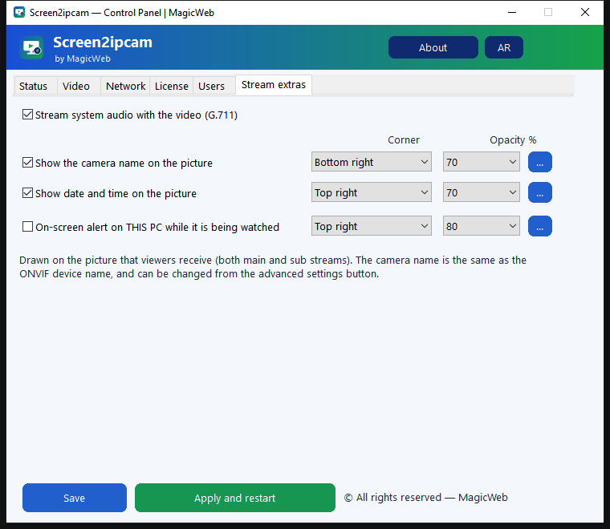

**Status tab**: the recorders connected right now
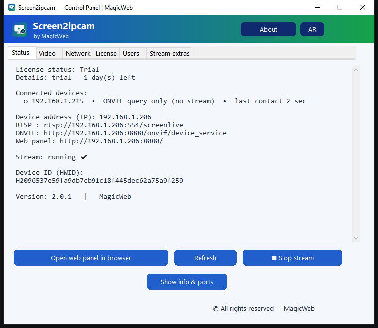

**Installer**: desktop shortcut, run at startup, and install as a Windows service
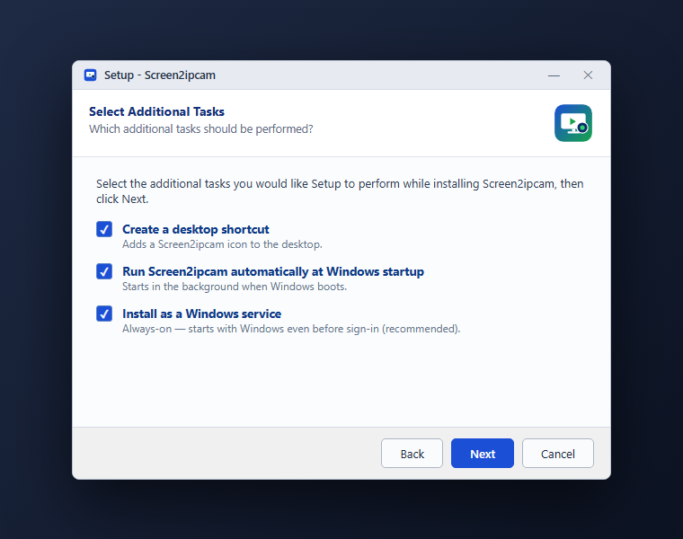

</details>

<br>

<a id="pricing"></a>
## 💲 Pricing

| | Free trial | Lifetime license |
|---|:---:|:---:|
| **Price** | **$0** | **$20**, one-time |
| Every feature unlocked | ✅ | ✅ |
| Duration | 14 days | **Forever** |
| Watermark after trial | n/a | **Never** |
| Activations | n/a | 1 PC (locked to its Device ID) |

The **Windows Server edition** uses the same lifetime license, **$20 per machine**. For 5 machines or more, ask for a quote on the site and all licenses are delivered together.

<div align="center">

**[Get your license at screen2ipcam.com →](https://screen2ipcam.com/?src=github#pricing)**

</div>

<br>

<a id="review"></a>
## ⭐ Reviewed by Softpedia

<div align="center">

<a href="https://www.softpedia.com/get/Internet/Streaming/Screen2ipcam.shtml"></a>&nbsp;


</div>

> **"Screen2ipcam essentially turns your computer into an IP camera."** Your computer is then recognized as such by your NVR, enabling you to monitor your security footage and computer screen from the same place, with the program facilitating this workflow through a straightforward setup process.
>
> **Stream your screen like an IP camera**: "Although turning your computer screen into an IP camera sounds like a complicated thing to do, that's not the case here. The software makes the whole process easy to go through, so you should be able to stream your screen within minutes of setting up the app. The connection to your surveillance device is handled via ONVIF … you can always input the RTSP address into VLC or a compatible player to check if the stream is active."
>
> **Comes with several options for customization**: "The program uses H.264 as the main codec, with options for tweaking resolution, frame rate, and bit rate … you can also opt for different RTSP and ONVIF ports from the app or web portal."
>
> Robert Condorache · [Full review on Softpedia](https://www.softpedia.com/get/Internet/Streaming/Screen2ipcam.shtml) · rated **5.0 / 5** · **Certified 100% Clean**

<details>
<summary><b>📷 Screenshots from the Softpedia review</b> <i>(click to expand)</i></summary>
<br>

|  |  |  |
|:--:|:--:|:--:|
| 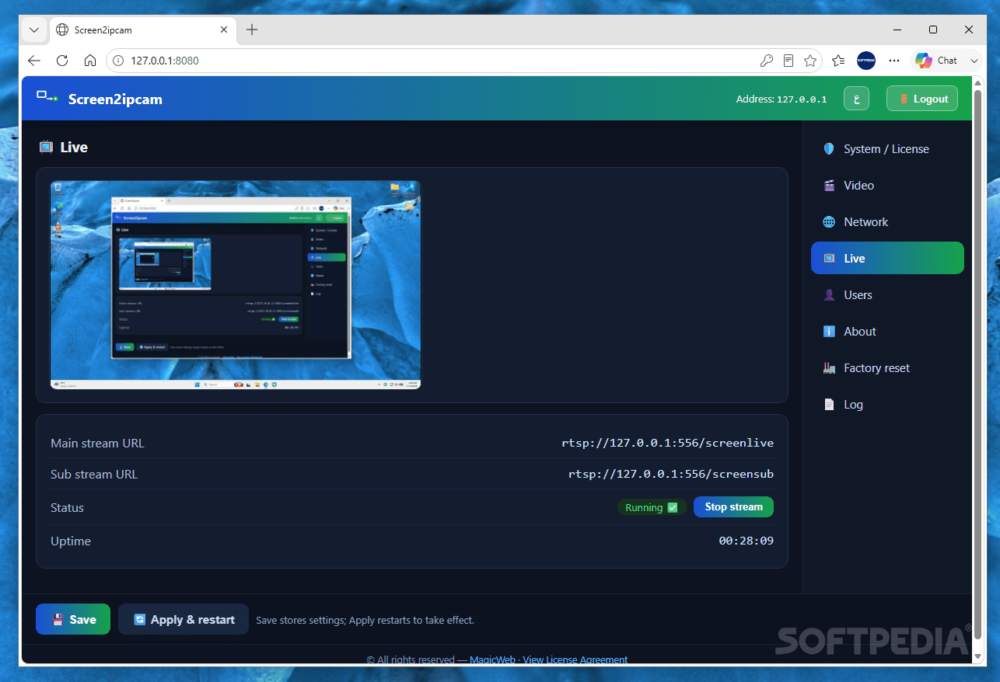 | 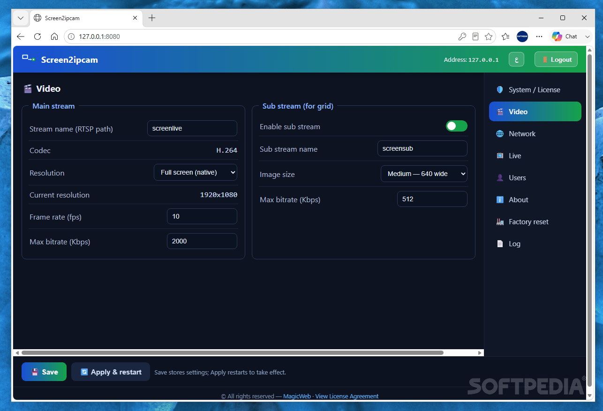 | 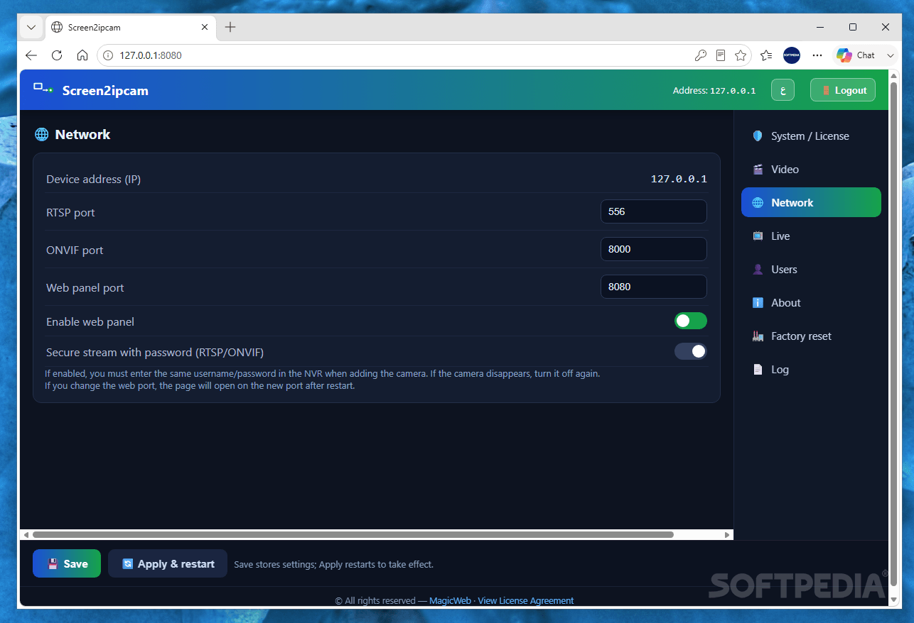 |
| **Web panel · Live** | **Web panel · Video** | **Web panel · Network** |
| 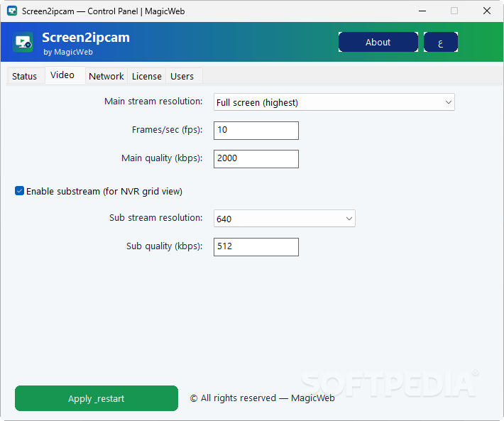 | 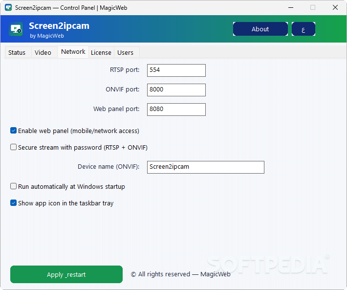 | 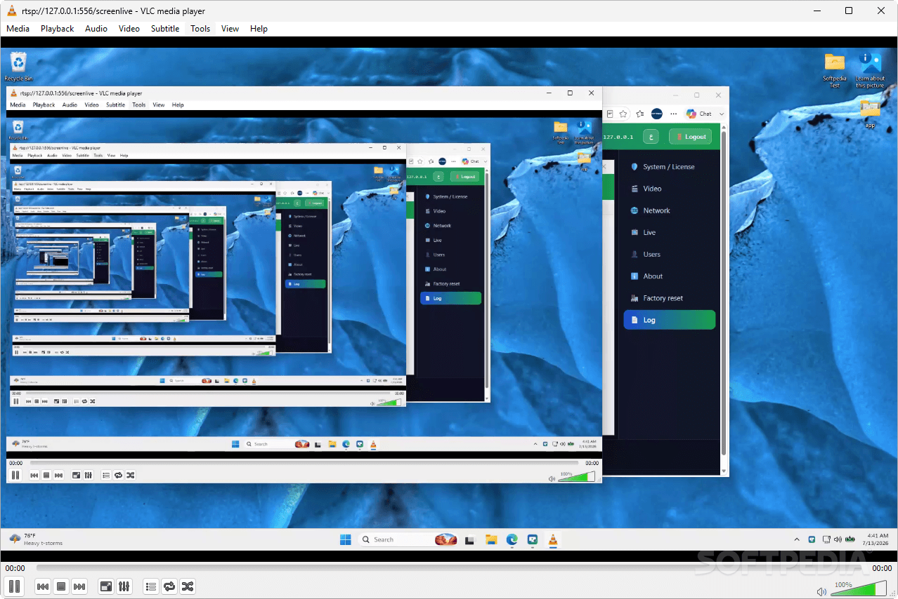 |
| **Desktop app · Video** | **Desktop app · Network** | **Verified in VLC (RTSP)** |

</details>

### 📚 Also listed on

[Softpedia](https://www.softpedia.com/get/Internet/Streaming/Screen2ipcam.shtml) · [Soft112](https://screen2ipcam.soft112.com/) · [Software Informer](https://screen2ipcam.software.informer.com/)

<br>

## ❓ FAQ

<details>
<summary><b>Which NVRs and software does it work with?</b></summary>
<br>

Any system that supports **ONVIF** or **RTSP**. Tested with **Hikvision**, **Dahua**, **Uniview**, **XMEye**, **Blue Iris** and **Agent DVR**; standard ONVIF/RTSP means enterprise VMS platforms (Milestone, Genetec, Nx Witness and others) ingest it too.
</details>

<details>
<summary><b>How long is the trial?</b></summary>
<br>

**14 days, fully functional.** A license unlocks the full version, no watermark and no time limit.
</details>

<details>
<summary><b>Can the recorder record only when the screen changes?</b></summary>
<br>

Yes, since **2.0.5**. Switch on **Send motion events to the recorder** in the Events tab, then enable motion recording for that channel on the recorder. It works over standard ONVIF, so Hikvision, Dahua, XMEye and the others treat it like motion from a real camera. The feature is off by default, and the **Send test event** button lets you confirm the recorder reacts without touching the screen. Details: [magicweb.win/motion](https://screen2ipcam.com/motion/?src=github).
</details>

<details>
<summary><b>Does it record sound?</b></summary>

Yes. It sends what the PC plays (not a microphone) inside the same
stream using **G.711**. It is off by default, and even when enabled it only runs while
a viewer is connected.

</details>

<details>
<summary><b>The recorder shows no sound. What do I set?</b></summary>

On the recorder's channel settings choose audio compression **G.711Mu** (also written
G.711 µ-law) and audio source **Local**. G.711A, PCM and AAC will not play.
And if the channel was added to the recorder **before** you switched audio on, remove
the channel and add it again: the recorder reads the camera's capabilities once, when
the channel is created. That is the most common cause of silent audio.

</details>

<details>
<summary><b>Does it keep streaming when nobody is logged in?</b></summary>
<br>

Use **[2.0.5 for Windows Server](#windows-server)**. Its service runs the camera on the logon screen itself, so after a reboot or a log off the recorder still sees the screen. It also keeps fixed ports (RTSP 554, ONVIF 18000, web panel 13030) and follows the active session when somebody connects over Remote Desktop.
</details>

<details>
<summary><b>Can I install it on many machines without clicking through the installer?</b></summary>
<br>

Yes, with the Windows Server edition. Set one PC up, save the settings to a file from the License tab, name it `Screen2ipcam-settings.txt` and keep it next to the installer. Then run `Screen2ipcam_Setup_2.0.5_WindowsServer_x64.exe /SILENT /SUPPRESSMSGBOXES` from your deployment tool. Each machine is licensed from the panel as usual.
</details>

<details>
<summary><b>My recorder keeps disconnecting every few seconds. Why?</b></summary>
<br>

Update to **2.0.5** or later. Some recorders (Uniview among them) send a periodic
check to the camera while the stream is running; older builds did not answer it, so
the recorder assumed the camera was gone and reconnected. After updating, delete the
channel in the recorder and add it again once.
</details>

<details>
<summary><b>The recorder sees the wrong IP address (VPN / virtual adapter)</b></summary>
<br>

Open the **VPN** tab in the control panel and pick exactly which address the camera
should announce. VPN and virtual adapters (Tailscale, Hyper-V, VMware, VirtualBox and
others) are detected and skipped automatically, and the built-in **network check**
confirms the recorder can actually reach that address before you add the channel.
</details>

<details>
<summary><b>Which Windows versions are supported?</b></summary>
<br>

**Windows 7 SP1 through Windows 11**, both 32-bit and 64-bit, including Windows IoT / Embedded / POSReady. The Windows Server edition runs on **Windows Server 2016 to 2025** as well. No .NET or extra runtimes needed.
</details>

<details>
<summary><b>Why does Windows show a notice when I run the installer?</b></summary>
<br>

SmartScreen sometimes shows a notice for a program it has not seen often. Click **More info**, then **Run anyway**. The installer is certified **100% Clean** by Softpedia, and the download always comes from the official site.
</details>

<details>
<summary><b>How do I get my license after paying?</b></summary>
<br>

Send your **Device ID** (from the app's License tab) through the [form on the site](https://screen2ipcam.com/?src=github#contact) or by email. We generate and send your license, usually within hours. Paste it into the License tab in any form, even on a single line. Each license activates **one PC**, locked to its Device ID.
</details>

<details>
<summary><b>How do I uninstall it?</b></summary>
<br>

**Settings → Apps**, or the **Uninstall Screen2ipcam** shortcut. It asks for the program password (default `admin` / `admin`), so a casual user can't remove it from a deployed PC. Forgot the password? Click **Forgot password?** on the web-panel login and email the Device ID to **support@magicweb.win** for a reset code.
</details>

<br>

<a id="comments"></a>
## 💬 Comments & feedback

Your feedback shapes the roadmap. Questions, ideas, setup stories, NVR compatibility reports, everything is welcome:

| | Where | For |
|---|---|---|
| 💬 | **[Discussions →](https://github.com/elpasha3000/Screen2ipcam/discussions)** | Comments, questions, ideas, show & tell |
| 🐞 | **[Issues →](https://github.com/elpasha3000/Screen2ipcam/issues)** | Bug reports, something didn't work |
| 📧 | **[support@magicweb.win](mailto:support@magicweb.win)** | Direct support & licensing |

Especially useful to us: your **NVR / VMS model**, **ONVIF discovery result**, and **streaming performance / CPU usage**.

<br>

---

<div align="center">


**Screen2ipcam**: Your Windows screen. Your IP camera.

🌐 **[screen2ipcam.com](https://screen2ipcam.com/?src=github)** &nbsp;·&nbsp; 📧 **[support@magicweb.win](mailto:support@magicweb.win)** &nbsp;·&nbsp; 🖧 **[Windows Server edition](https://screen2ipcam.com/windows-server/?src=github)** &nbsp;·&nbsp; 📝 **[Release notes](https://screen2ipcam.com/updates.html?src=github)**

⭐ *If Screen2ipcam is useful to you, a star helps others find it.*

<sub>© MagicWeb. All rights reserved.</sub>

</div>
